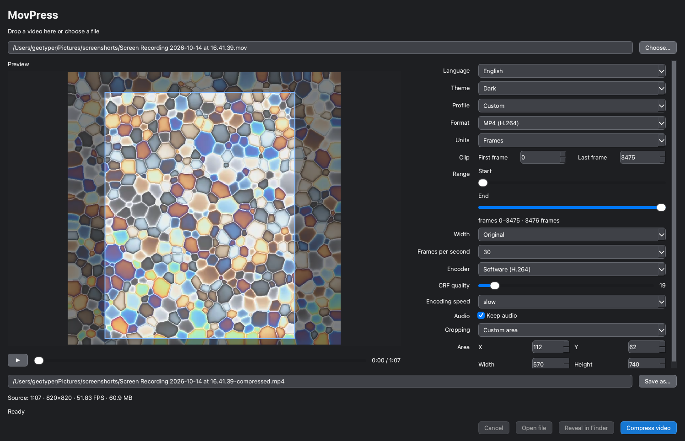

# MovPress

[Русская версия](README_RUS.md)

**[Download for macOS (Apple Silicon)](https://github.com/geotyper/movpress/releases/latest)**

Unzip the archive and open `MovPress.app`. `ffmpeg` and `ffprobe` are included. If macOS says the app is damaged, run `xattr -dr com.apple.quarantine MovPress.app` in that folder and open it again.

**[Windows amd64 build](https://github.com/geotyper/movpress/actions?query=branch%3Afeature%2Fwindows-amd64)**

Unzip the archive and run `MovPress.exe`. Qt, `ffmpeg`, and `ffprobe` are in the same folder.

MovPress is a lightweight application for compressing screen recordings and creating optimized GIFs. It provides a Qt 6 desktop interface and uses `ffmpeg` and `ffprobe` for media processing. macOS and Windows packages include those tools.



## Features

- Export to MP4/H.264 or GIF with an adaptive color palette
- Built-in playback of both the source and converted video
- Side-by-side video preview and compression settings
- Visual selection of the clip start and end points
- Time-based or frame-accurate trim controls
- Preview playback limited to the selected clip range
- Custom start time and duration
- Configurable resolution, frame rate, CRF, and encoding preset
- Hardware H.264 encoders when the bundled or installed `ffmpeg` provides them
- Optional audio preservation
- Custom video cropping, including a rectangle dragged on the preview
- Ready-to-use profiles for YouTube, Habr, Telegram, and maximum compression
- Drag-and-drop video selection
- Accurate conversion progress reported by `ffmpeg`
- Before-and-after file size comparison and space-saving percentage
- Conversion cancellation
- Open the result or reveal it in Finder or Explorer
- Persistent settings and last-used directory
- English interface by default, with Russian available from the Language menu
- System, light, and dark appearance modes
- Warnings before overwriting files or when disk space is low

## Requirements

- macOS or Windows
- CMake 3.21 or newer
- A C++20 compiler
- Qt 6.5 or newer with Widgets, Multimedia, and MultimediaWidgets
- `ffmpeg` and `ffprobe` at build time so they can be copied into the app, or on `PATH`, `/opt/homebrew/bin`, or `/usr/local/bin` at runtime

## Build

Install the dependencies with Homebrew:

```bash
brew install qt ffmpeg
```

Configure and build the application:

```bash
cmake -S . -B build -DCMAKE_PREFIX_PATH="$(brew --prefix qt)"
cmake --build build
open build/MovPress.app
```

When using a Qt installation created by the official Qt installer, invoke its `qt-cmake` directly:

```bash
/path/to/Qt/6.x.x/macos/bin/qt-cmake -S . -B build
cmake --build build
open build/MovPress.app
```

## Tests

The project includes small Qt Test checks for trim-range normalization, crop bounds, pixel alignment, and FFmpeg video-filter construction:

```bash
cmake -S . -B build -DBUILD_TESTING=ON -DCMAKE_PREFIX_PATH="$(brew --prefix qt)"
cmake --build build
ctest --test-dir build --output-on-failure
```

## Usage

1. Drop a video onto the application or select it using the file dialog.
2. Preview the video and select the required fragment.
3. Choose a ready-made profile or adjust the compression settings manually.
4. Select the output path and start the conversion.
5. Preview the converted file, open it, or reveal it in Finder or Explorer.

The application starts in English by default. Select `Language` at the top of the settings panel to switch between English and Russian. MovPress restarts automatically to apply the new language.

## Configuration

MovPress stores its persistent settings in a human-readable `movpress.ini` file inside the application configuration directory returned by Qt. On macOS this directory is located under the current user's `~/Library/Preferences` folder. Hover over the theme selector to see the exact path used on your system.

Existing settings from the earlier native macOS preferences storage are migrated automatically when the INI file is created for the first time.

## Status

MovPress is under active development. Current version: 0.1.0.
